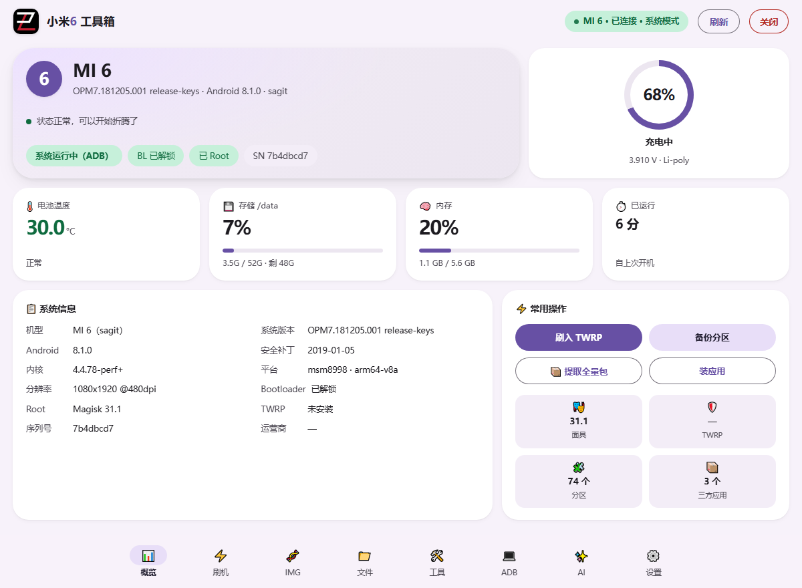
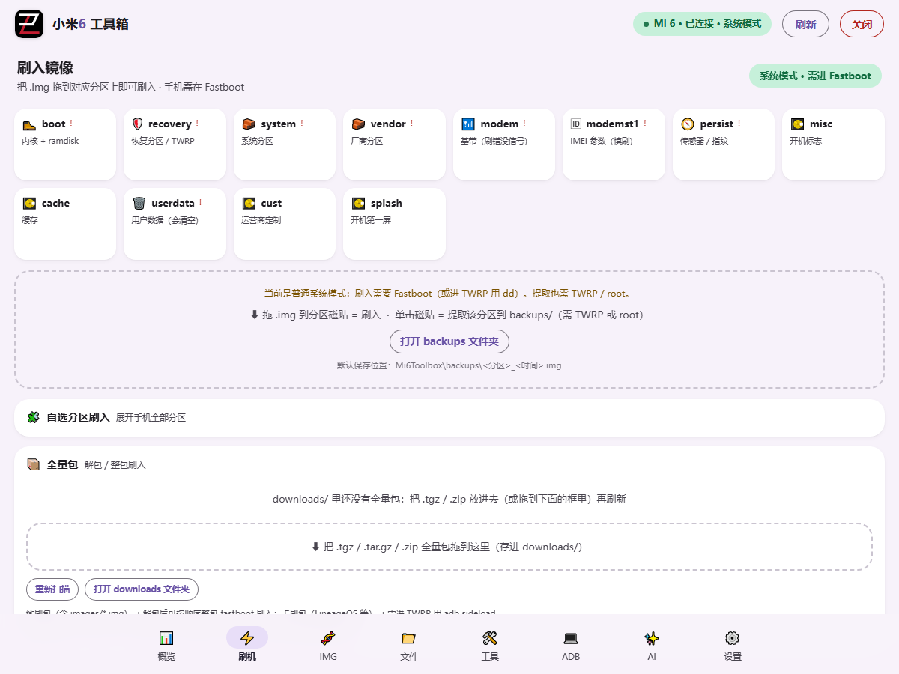
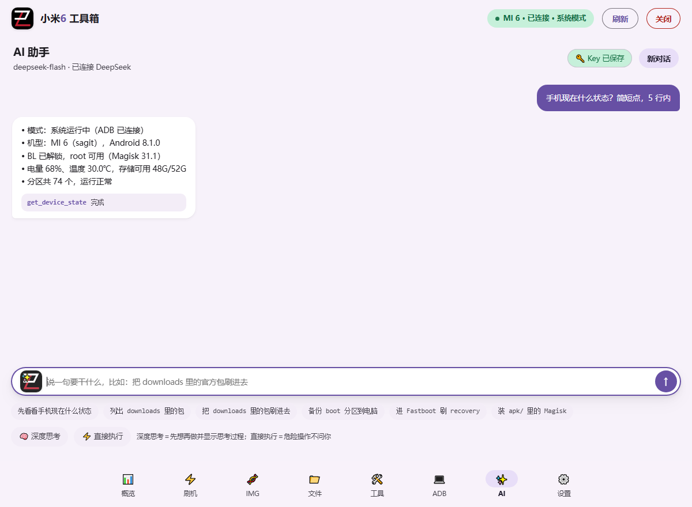

# 小米6 工具箱 · Web UI
致敬每个小米6钉子户
> 小米6（sagit）刷机与维护工具箱，本地网页界面，Material 3 风格。**自带 Python 3.11，双击即用。**



把 adb / fastboot 的日常操作、全量包线刷、boot 镜像解包改包，还有一个能自己动手的 AI 助手，装进一个本地 Web UI 里。
跑在 `127.0.0.1`，用 Edge 应用模式开窗（没有地址栏，像个正经桌面软件）；数据全在本机，只有 AI 需要联网。

## 亮点

- **不用背命令**：把 `.img` 拖到分区磁贴上就是 `fastboot flash`，单击磁贴就是把该分区 dump 回电脑
- **全量包一条龙**：官方 `.tgz` 线刷包 → 检查 → 解包 → 按安全顺序整包刷；LineageOS 那种卡刷包自动识别成 `adb sideload`
- **IMG 改包**：解包 boot/recovery → 直接编辑 ramdisk 里的文本 → 重打包 → 刷回去，全程图形界面
- **AI 会自己动手**：说"把 downloads 里的包刷进去"，它会查状态、解包、刷机；危险操作默认先问你，勾上「直接执行」才全自动，生成中随时能按 ■ 停
- **能带走**：`python-embed/` 里是官方 embeddable Python，整个文件夹拷到另一台 Windows 电脑，双击 `启动.bat` 就能用

## 截图

| 刷机 | AI 助手 |
|---|---|
|  |  |

## 快速开始

**方式一：完整包（推荐）**
下载 Release 里的 zip，解压，双击 `启动.bat`。里面已经带好 Python 和 platform-tools，不用装任何东西。

**方式二：从源码跑**

```bat
git clone https://github.com/<你的用户名>/Mi6Toolbox.git
cd Mi6Toolbox
python webui\serve.py          :: 需要系统 Python 3.8+
```

`启动.bat` 找不到 `python-embed\` 会自动退回系统 Python；`tools\platform-tools\`（adb/fastboot）和
`python-embed\`（[embeddable 包](https://www.python.org/downloads/windows/)）需要自己放回去。

**要求**：Windows 10/11、Edge、一根能连手机的数据线。手机要开 USB 调试。

## 功能

| 页面 | 能干什么 |
|---|---|
| **概览** | 自适应仪表盘：电量环、温度/存储/内存/运行时长、系统信息（内核、安全补丁、平台、分辨率）、BL/Root/面具/TWRP/分区数；连接状态按模式分色（系统绿 / TWRP 黄 / Fastboot 蓝 / 待授权红闪） |
| **刷机** | 12 个常见分区磁贴 + 自选全部分区；拖 `.img` 刷入、单击提取；下方「全量包」解包 / 整包刷 / sideload |
| **IMG** | boot/recovery 解包，ramdisk 文件树 + 文本编辑器，重打包成新 img，一键刷入 |
| **文件** | 浏览 `/sdcard`，点文件存到电脑并自动在资源管理器选中；拖文件进窗口上传 |
| **工具** | 常用 adb 命令磁贴 |
| **ADB** | 终端：进页面直接打字，Tab 补全命令/`adb` 子命令/属性名/服务名/包名/手机路径，↑↓ 翻历史，命令与报错分色 |
| **AI** | DeepSeek：流式回复 + 深度思考过程 + 函数调用（查状态/解包/刷机/重启/装应用），危险操作确认，随时可停 |
| **设置** | 主题（浅/深/跟随）、5 种强调色、磁贴大小、界面动效、开屏动画、启动赞赏码、自动刷新、终端配色、危险操作确认 |

## 全量包怎么刷

1. 把 `.tgz / .tar.gz / .zip` 放进 `downloads/`（或直接拖进页面）
2. 点「检查」：不解包就能看到里面有哪些镜像、是什么类型的包
3. 点「解包」：把镜像解到 `backups/`
4. 点「整包刷入」：按 `boot → recovery → system → vendor → cust → modem …` 顺序逐个刷，单步失败就停

- **默认跳过** `misc / persist / modemst1 / modemst2 / fsg / cache`（这些不该无脑刷），要刷得自己点
- 含 `META-INF` 或 `payload.bin` 的卡刷包 → 识别为 sideload，要先进 TWRP 的 sideload 模式
- 解包会拒绝含 `..`、绝对路径、符号链接的包；刷之前先确认手机在 Fastboot，免得解完几个 G 才报错

## IMG 解包 / 重打包

- 列表里先标出每个 `.img` 到底是什么：🥾 boot 镜像 / 💽 ext4 / 💽 FAT / ⬜ 空分区 / 🧩 sparse / 🗜️ 压缩镜像 / ❔ 非 boot。
  分区 dump 不都是 boot 镜像，`persist`/`cust` 是 ext4、`modem` 是 FAT、`misc` 常常整片是 0
- 支持 boot header **v0 / v1 / v2**（小米6 实测 v0，page 4096），ramdisk 支持 gzip / xz / 未压缩
- 重打包会重算 cpio、按原方式压缩、重写 header 的 size/offset 和 v1/v2 的 SHA1
- **不支持**：lz4 ramdisk、header v3/v4（Android 13+）、稀疏镜像（先用 `simg2img`）

## AI 说明

- 只支持 DeepSeek 官方接口，默认 `deepseek-flash`（旧名会自动兜底重试）
- **深度思考**：走 `thinking: {type: enabled}` + `reasoning_effort`，思维链 `reasoning_content` 流式返回，页面上是一块可折叠的「思考过程」
- **随时能停**：生成中发送按钮变红色 ■，点了服务端立刻收手，停下来可以直接接着发
- **不会被"重启断连"骗到**：小米6 一重启 ADB 会断 10~60 秒，工具里有 `wait_for_device`，模型会等它回来而不是让你去检查数据线
- API Key 用 **Windows DPAPI** 加密存在 `data/secrets.json`，只有当前 Windows 账户能解；换电脑要重填

## 安全提醒

- 刷机本来就有风险，**刷错分区可能开不了机**。工具里所有写操作都会二次确认（设置里能关，但别关）
- 默认不碰 `persist / modemst / fsg / misc` 这类涉及 IMEI、基带、传感器校准的分区
- 第一次用建议先「备份分区」，把 boot / recovery / modem / persist 存一份到 `backups/`
- 解 BL 会清数据，请先备份

## 目录结构

```
Mi6Toolbox/
├─ 启动.bat              双击启动
├─ webui/
│  ├─ serve.py           后端：静态文件 + JSON API + adb/fastboot + DeepSeek 代理
│  └─ static/            前端单文件 + logo/图标
├─ toolbox/
│  ├─ adb.py fastboot.py device.py util.py config.py
│  ├─ rom.py             全量包解析 / 解包 / 整包刷 / sideload
│  ├─ bootimg.py         boot 镜像解包 / ramdisk 编辑 / 重打包
│  └─ ai.py              DeepSeek function calling + DPAPI 存 Key
├─ python-embed/         内置 Python 3.11（源码仓库不含，见 Release）
├─ tools/platform-tools/ adb / fastboot（源码仓库不含）
├─ apk/                  一键安装的 apk
├─ downloads/ backups/   下载中转、分区备份
└─ docs/                 README 截图
```

## 已知限制

- 只操作一台设备：同时插两台时取第一个
- TWRP 里不能用 `adb install` 装应用（没有包管理器）
- 只支持 Windows（DPAPI 存 Key、Edge 开窗、资源管理器选中文件）
- 请求都跑在本机 HTTP 上，只监听 `127.0.0.1`，别把端口映射到公网

## 关于

作者 **BuFenKJ**，由 **DeepSeek** 编写。如果这个工具箱帮到你了，可以在应用「设置 → 关于」里扫赞赏码，我将持续跟进开发

## 致谢

- [Android platform-tools](https://developer.android.com/tools/releases/platform-tools)（adb / fastboot）
- [Python embeddable package](https://www.python.org/downloads/windows/)
- [DeepSeek API](https://api.deepseek.com)
